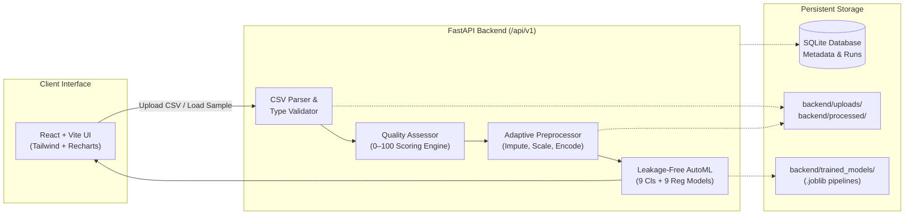

# Intelligent Data Quality Assessment and AutoML Assistant

[](https://fastapi.tiangolo.com)
[](https://react.dev)
[](https://scikit-learn.org)
[](https://tailwindcss.com)
[](LICENSE)

An end-to-end, academic minor-project platform for automated **Data Quality Assessment**, **Adaptive Preprocessing**, and **AutoML Model Benchmarking** for tabular CSV datasets.

---

## 📌 Architecture & System Flow



---

## ✨ Key Features

1. **Dynamic CSV Ingestion & Validation**
   - Automatically detects encoding (`utf-8`, `latin-1`, `cp1252`) and delimiters (`,`, `;`, `\t`, `|`).
   - Dynamically analyzes column types (`numeric`, `categorical`, `boolean`, `id`, `datetime`).
   - Robust error detection for malformed rows, duplicate headers, and small sample sizes.

2. **Automated Data Quality Assessment (0–100 Score)**
   - Calculates transparent penalty deductions for missing cells, duplicates, IQR outliers, zero-variance columns, high cardinality, and class imbalance.
   - Provides plain-language explanations for every score deduction.
   - Univariate summaries, Pearson correlation matrix ($|r| \ge 0.75$ alerts), and IQR outlier thresholds.

3. **Tailored Data Preprocessing Studio**
   - One-click **"Apply Recommended Settings"** based on dataset diagnostic findings.
   - Configurable imputation (median, mean, mode, 'Unknown', drop rows).
   - Categorical encoding (One-Hot, Ordinal) and numerical scaling (StandardScaler, MinMaxScaler).
   - IQR Winsorization capping and outlier row filtering.
   - Before-and-after statistics comparison diff and exportable processed CSV.

4. **AutoML Training Hub with Zero Data Leakage (9 Classification + 9 Regression Algorithms)**
   - Built with Scikit-Learn `Pipeline` & `ColumnTransformer` fitted strictly on `X_train`.
   - **Classification Suite (9 Models)**:
     1. Logistic Regression
     2. Decision Tree Classifier
     3. Random Forest Classifier
     4. Extra Trees Classifier
     5. Gradient Boosting Classifier
     6. AdaBoost Classifier
     7. K-Nearest Neighbors Classifier
     8. Support Vector Classifier
     9. Gaussian Naive Bayes
   - **Regression Suite (9 Models)**:
     1. Linear Regression
     2. Ridge Regression
     3. Decision Tree Regressor
     4. Random Forest Regressor
     5. Extra Trees Regressor
     6. Gradient Boosting Regressor
     7. AdaBoost Regressor
     8. K-Nearest Neighbors Regressor
     9. Support Vector Regressor
   - True Leaderboard ranking (weighted F1-score for classification, R² score for regression).
   - Metrics: Weighted F1-score, Accuracy, Precision, Recall, Macro F1, Confusion Matrix, R² Score, RMSE, MAE, MSE.
   - Recommendation engine with plain-language explanation of why the top model was selected.

5. **Model Artifact Export & Live Inference Playground**
   - Export fitted pipelines as portable `.joblib` files.
   - Interactive prediction form to test real-time predictions and class probability distributions directly in the browser.

6. **Full Audit History & SQLite Persistence**
   - Tracks all datasets, diagnostic quality reports, preprocessing histories, and model training runs in SQLite.

---

## 📁 Repository Directory Structure

```text
d:/Minor_project_5th_sem/
├── backend/
│   ├── app/
│   │   ├── api/                  # FastAPI REST routes (datasets, quality, preprocessing, automl, history)
│   │   ├── core/                 # Core logic (validator, quality_assessor, preprocessor, automl_engine)
│   │   ├── utils/                # File management and logging
│   │   ├── config.py             # App settings and directory paths
│   │   ├── database.py           # SQLite SQLAlchemy session setup
│   │   ├── models.py             # ORM models (Datasets, QualityReports, ModelRuns)
│   │   ├── schemas.py            # Pydantic validation schemas
│   │   └── main.py               # Application entry point & CORS
│   ├── sample_data/              # Synthetic demo datasets (student_performance.csv, housing_prices.csv)
│   ├── uploads/                  # Stored original uploaded CSVs
│   ├── processed/                # Stored preprocessed CSVs
│   ├── trained_models/           # Serialized .joblib pipelines
│   ├── tests/                    # 17 pytest unit & integration tests
│   ├── requirements.txt          # Python dependencies
│   └── Dockerfile                # Backend container image
├── frontend/
│   ├── src/
│   │   ├── api/                  # Axios REST client and TypeScript interfaces
│   │   ├── components/           # Reusable UI components (Quality, Preprocessing, AutoML, History)
│   │   ├── context/              # Global AppContext state management
│   │   ├── pages/                # Page views (Dashboard, Upload, Quality, Preprocessing, AutoML, History)
│   │   ├── test/                 # Vitest component test suite
│   │   ├── App.tsx               # Main application shell
│   │   ├── index.css             # Tailwind CSS & glassmorphism theme
│   │   └── main.tsx              # React entry point
│   ├── package.json              # Node.js dependencies
│   ├── vite.config.ts            # Vite & Vitest configuration
│   ├── tailwind.config.js        # Tailwind CSS theme configuration
│   ├── nginx.conf                # Nginx production configuration
│   └── Dockerfile                # Multi-stage frontend container image
├── docs/
│   ├── architecture.md           # System design & leakage prevention details
│   ├── api_reference.md          # REST endpoint specifications
│   └── viva_presentation_guide.md# Viva presentation script & 15 technical Q&As
├── docker-compose.yml            # Docker multi-container orchestration
├── README.md                     # Project documentation
├── .env.example                  # Environment configuration template
├── .gitignore                    # Git ignore file
└── .dockerignore                 # Docker ignore file
```

---

## 🚀 Quickstart: Running Locally (Without Docker)

### 1. Prerequisites
- **Python**: 3.10, 3.11, or 3.12
- **Node.js**: v18.0.0 or higher
- **npm**: v9.0.0 or higher

---

### 2. Backend Setup
Open a terminal in the project root:

```bash
# Navigate to project root
cd d:/Minor_project_5th_sem

# Install Python dependencies
python -m pip install -r backend/requirements.txt

# Start FastAPI backend server (runs on port 8000)
uvicorn backend.app.main:app --reload --port 8000
```
Backend API will be live at: **`http://localhost:8000`**  
Interactive Swagger API documentation: **`http://localhost:8000/docs`**

---

### 3. Frontend Setup
Open a second terminal window:

```bash
# Navigate to frontend directory
cd d:/Minor_project_5th_sem/frontend

# Install dependencies
npm install

# Start Vite dev server (runs on port 5173)
npm run dev
```
Frontend web application will be live at: **`http://localhost:5173`**

---

## 🐳 Running with Docker & Docker Compose

To run the entire full-stack application inside isolated containers:

```bash
# Build and run backend and frontend services
docker-compose up --build
```

- **Frontend App**: `http://localhost` (or `http://localhost:3000`)
- **Backend API**: `http://localhost:8000`
- **Swagger Docs**: `http://localhost:8000/docs`

To stop containers:
```bash
docker-compose down
```

---

## 🧪 Running Automated Tests

### 1. Backend Tests (Pytest)
```bash
# Run all 17 backend unit and integration tests
python -m pytest backend/tests -v
```

### 2. Frontend Tests (Vitest + React Testing Library)
```bash
# Run all frontend component tests
cd frontend
npx vitest run
```

---

## 🎯 How to Demonstrate the Project (Viva Demo Walkthrough)

### 1. Classification Demonstration
1. Open `http://localhost:5173` in your browser.
2. On the **Dashboard**, click **"Load Classification Demo"** (`student_performance.csv`).
3. The app navigates to the **Quality Report** tab:
   - Observe the **Quality Score Gauge** (e.g. 91.5/100, Grade: Excellent).
   - Review the **Score Deductions Audit** showing points deducted for missing study hours and duplicate rows.
   - Inspect the **Missing Values Bar Chart**, **IQR Outlier Table**, and **Correlation Matrix**.
4. Go to the **Preprocessing** tab:
   - Click **"Apply Recommended Presets"** (selects median imputation for numeric gaps, mode imputation for categorical gaps, and drops the `Student_ID` column).
   - Click **"Apply Preprocessing Pipeline"**.
   - Review the **Before-and-After Comparison Cards** (missing values dropped to 0).
   - Click **"Download Processed CSV"** to save the clean dataset.
5. Go to the **AutoML Hub** tab:
   - Select target column `Passed_Exam` (auto-detected as **Classification**).
   - Click **"Train & Compare Models"**.
   - View the **Model Leaderboard**: compares Logistic Regression, Decision Tree, Random Forest, KNN, and SVC.
   - Inspect the **Metric Comparison Chart**, **Confusion Matrix Heatmap**, and **Recommendation Rationale Card**.
   - Click **"Download Trained Pipeline (.joblib)"**.
6. Scroll down to the **Live Inference Playground**:
   - Enter test inputs (e.g., Study Hours = `30`, Attendance = `95%`, Previous Score = `85`).
   - Click **"Predict Output"** to observe real-time predicted class (`Pass`) and class probabilities.

### 2. Regression Demonstration
1. On the **Dashboard**, click **"Load Regression Demo"** (`housing_prices.csv`).
2. Go to **AutoML Hub**, select target `Price` (auto-detected as **Regression**).
3. Click **"Train & Compare Models"**.
4. Observe the ranking based on **R² Score** (explaining continuous variance) and **Root Mean Squared Error (RMSE)**.

### 3. Custom Arbitrary CSV Upload
1. Go to the **Upload & Preview** tab.
2. Drag and drop any custom tabular CSV file.
3. The system dynamically parses columns, validates integrity, calculates data quality, applies preprocessing, and trains ML models without any hardcoded column assumptions.

---

## 📖 Additional Documentation

- [System Architecture & Leakage Prevention](docs/architecture.md)
- [REST API Reference](docs/api_reference.md)
- [Academic Viva Presentation Guide & 15 Technical Q&As](docs/viva_presentation_guide.md)

---

## 📜 Limitations & Future Scope
- **Current Scope**: Optimized for tabular CSV datasets up to 50MB with standard numerical and categorical features.
- **Future Enhancements**: Support for automated hyperparameter tuning (GridSearchCV / Optuna), time-series forecasting algorithms, deep learning neural network classifiers (PyTorch / TensorFlow), and multi-label classification.
