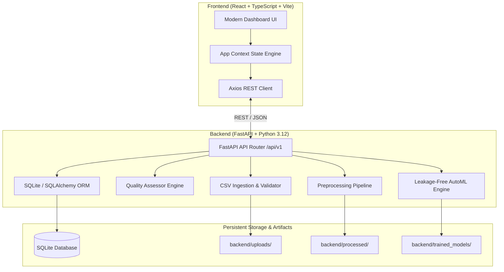

# System Architecture & Technical Specifications

## 1. High-Level Architecture Overview

The **Intelligent Data Quality Assessment and AutoML Assistant** is built as a modular, decoupled full-stack machine learning engineering application.



---

## 2. Core Subsystems

### 2.1 CSV Validation & Data Type Inference Subsystem
- **Encoding Sniffing**: Iterates through `utf-8`, `utf-8-sig`, `latin-1`, `cp1252`, and `iso-8859-1` with automatic fallback.
- **Delimiter Detection**: Uses Python `csv.Sniffer` dialect detection to handle `,`, `;`, `\t`, and `|`.
- **Dynamic Semantic Type Inference**:
  - `numeric`: continuous or discrete mathematical features.
  - `categorical`: low-to-medium cardinality discrete string/object values.
  - `boolean`: binary truth flags (e.g., True/False, 0/1, Yes/No).
  - `id`: unique high-cardinality sequential or alphanumeric keys (e.g. `Student_ID`, `PROP_2001`).
  - `datetime`: timestamp strings.

### 2.2 Data Quality Scoring Algorithm
The overall dataset quality score starts at a maximum of **100.0 points** and applies proportional transparent penalties:
1. **Missing Data Penalty**: Up to -30 points (`0.6 × missing_percentage`).
2. **Duplicate Records Penalty**: Up to -20 points (`1.5 × duplicate_percentage`).
3. **IQR Outlier Ratio Penalty**: Up to -15 points (`0.5 × numeric_outlier_percentage`).
4. **Zero-Variance / Constant Column Penalty**: -5 points per constant column (up to -15).
5. **High-Cardinality Categorical Penalty**: -3 points per high-cardinality categorical feature (up to -10).
6. **Class Imbalance Penalty**: -7 points if majority-to-minority ratio exceeds 2.5:1.

$$\text{Quality Score} = \max\left(0, 100 - \sum \text{Deductions}\right)$$

### 2.3 Strict Data Leakage Prevention in AutoML
All transformers (`SimpleImputer`, `StandardScaler`, `OneHotEncoder`) are bundled inside a Scikit-Learn `ColumnTransformer` and encapsulated within an end-to-end `Pipeline`.

```
                    Raw Training Split (X_train)
                               │
            ┌──────────────────┴──────────────────┐
            ▼                                     ▼
   Numeric Transformers                Categorical Transformers
  [SimpleImputer(median)]               [SimpleImputer(mode)]
  [StandardScaler()]                    [OneHotEncoder(handle_unknown)]
            │                                     │
            └──────────────────┬──────────────────┘
                               │
                               ▼
                    Fitted Estimator (Model)
                               │
                Persisted Pipeline (.joblib)
```

- Transformers are **fitted ONLY on `X_train`**.
- Unseen test rows (`X_test`) and future single-instance inference inputs pass through the pre-fitted pipeline without re-computing mean, median, variance, or category dictionaries.

---

## 3. Supported Machine Learning Algorithms

### Classification Suite (9 Models):
1. **Logistic Regression**: Linear generalized linear model with L-BFGS solver.
2. **Decision Tree Classifier**: Non-linear tree partitioning with depth regularization.
3. **Random Forest Classifier**: Ensemble of 100 bagging decision trees with bootstrap aggregation.
4. **Extra Trees Classifier**: Extremely randomized trees ensemble for enhanced variance reduction.
5. **Gradient Boosting Classifier**: Stage-wise boosting optimizing cross-entropy loss.
6. **AdaBoost Classifier**: Adaptive boosting sequential ensemble emphasizing misclassified samples.
7. **K-Nearest Neighbors Classifier**: Non-parametric instance-based metric clustering.
8. **Support Vector Classifier (SVC)**: Radial basis function (RBF) kernel margin classifier with calibrated probability outputs.
9. **Gaussian Naive Bayes**: Probabilistic Bayes classifier with Gaussian likelihood assumption.

### Regression Suite (9 Models):
1. **Linear Regression**: Ordinary Least Squares (OLS) closed-form estimator.
2. **Ridge Regression**: L2-penalized linear regression for stability under collinear features.
3. **Decision Tree Regressor**: Piecewise constant tree approximation.
4. **Random Forest Regressor**: 100-tree ensemble reducing variance and overfitting.
5. **Extra Trees Regressor**: Extremely randomized regression trees for smooth continuous surfaces.
6. **Gradient Boosting Regressor**: Gradient-boosted sequential regression minimizing squared error.
7. **AdaBoost Regressor**: Boosting meta-estimator for continuous numerical prediction.
8. **K-Nearest Neighbors Regressor**: Local distance-weighted continuous interpolation.
9. **Support Vector Regressor (SVR)**: Epsilon-insensitive margin regression.
